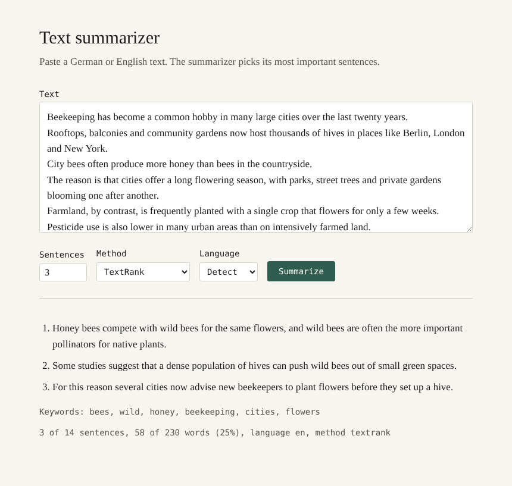

# Text summarizer

Extractive text summarizer for German and English, written in plain Java 17. It picks the most important sentences of a text with TextRank or word frequency scoring, extracts keywords with TF-IDF, and runs as a command line tool or as a small web app with an HTTP API. No libraries apart from JUnit.



## Example

```
$ java -jar target/text-summarizer-1.0.0.jar -n 2 samples/dubai_de.txt

Dubai ist eine Stadt, in der Moderne und Luxus auf einzigartige Weise miteinander verschmelzen. In Dubai trifft man Menschen aus aller Welt, was der Stadt eine kosmopolitische Atmosphäre verleiht.

Keywords: dubai, stadt, leben, menschen, moderne
2 of 15 sentences, 29 of 160 words (18%), language de, method textrank
```

## Features

- Two scoring algorithms: TextRank (graph based, default) and word frequency after Luhn
- Detects whether a text is German or English and uses the matching stop words and sentence rules
- Keyword extraction with TF-IDF
- Summary length as a number of sentences or as a share of the text
- Output as plain text, Markdown or JSON
- Several files are summarized in parallel on a thread pool, with results in input order
- Web interface and JSON API on the JDK's built-in HTTP server, bound to localhost only
- Input validation: size limit for API requests, clear error messages and exit codes

## How it works

The summarizer is extractive: it does not write new text, it selects sentences from the original and keeps them in their original order.

1. The text is split into sentences with the JDK's locale-aware `BreakIterator` and into words with a Unicode regex, so umlauts and ß stay intact.
2. The language is detected by counting German and English stop words. Stop words (der, und, the, and) are then removed, and only content words are kept.
3. Every sentence gets a score from one of two algorithms:
   - TextRank builds a graph where sentences are nodes and shared words are weighted edges, then runs PageRank on it. A sentence that resembles many other sentences ranks high. Similarity follows the TextRank paper: shared words divided by `log(len a) + log(len b)`.
   - Word frequency counts how often each content word appears in the whole text. A sentence scores the average frequency of its words.
4. The best sentences are selected and put back in their original order.
5. Keywords are ranked by TF-IDF, treating each sentence as a document: frequent words score high, words that appear in nearly every sentence are weighted down.

## Running it

Requires Java 17 or newer and Maven.

```bash
mvn package
java -jar target/text-summarizer-1.0.0.jar samples/city_bees_en.txt
```

Options:

```
-n, --sentences N     number of sentences to keep (default 3)
-r, --ratio R         share of sentences to keep instead, e.g. 0.3
-m, --method M        textrank (default) or frequency
-l, --lang L          de, en or auto (default auto)
-k, --keywords N      number of keywords, 0 for none (default 5)
-f, --format F        text (default), markdown or json
-t, --threads N       parallel threads for several files (default: CPU cores)
    --serve [PORT]    start the web interface and HTTP API (default port 8080)
```

Without a file the text is read from standard input:

```bash
cat article.txt | java -jar target/text-summarizer-1.0.0.jar -r 0.2 -f markdown
```

Exit codes: 0 success, 1 a file could not be read, 2 invalid arguments.

### Web interface and API

```bash
java -jar target/text-summarizer-1.0.0.jar --serve
```

Open http://localhost:8080 for the web page, or call the API directly:

```bash
curl -X POST --data-binary @samples/dubai_de.txt "http://localhost:8080/api/summarize?sentences=2&keywords=3"
```

Query parameters: `sentences`, `ratio`, `method`, `lang`, `keywords`. The response is JSON:

```json
{"language":"de","method":"textrank","summary":"...","sentences":[{"position":0,"text":"..."}],
 "keywords":[{"word":"dubai","score":6.233}],
 "stats":{"originalSentences":15,"summarySentences":2,"originalWords":160,"summaryWords":29,"compression":0.181,"originalReadingMinutes":1}}
```

Errors return status 400 (invalid parameter or empty text), 405 (wrong HTTP method) or 413 (text over 1 MB) with a JSON message.

## Tests

```bash
mvn test
```

50 JUnit 5 tests cover sentence splitting, language detection, both scoring algorithms, keyword extraction, output formats including JSON escaping, argument parsing, parallel batch processing and every API response code. The server tests start the server on a free port and send real HTTP requests.

## Project structure

| Class | Responsibility |
|---|---|
| `Main`, `CliOptions` | command line entry point and argument parsing |
| `Summarizer` | runs the pipeline: split, score, select, restore order |
| `TextProcessor` | sentence and word splitting |
| `Language` | stop word lists and language detection |
| `SentenceScorer` | interface for scoring algorithms |
| `TextRankScorer`, `FrequencyScorer` | the two algorithms |
| `KeywordExtractor` | TF-IDF keywords |
| `Summary`, `SummaryOptions` | result and settings as Java records |
| `OutputFormat` | text, Markdown and JSON output |
| `BatchSummarizer` | parallel processing with an `ExecutorService` |
| `SummaryServer` | web page and JSON API on `com.sun.net.httpserver` |

## Limitations

- Words are not reduced to their stem, so "bee" and "bees" count as different words.
- Only German and English stop words are included.
- Extractive summaries can lose context when a chosen sentence refers to an earlier one ("This is why...").

## History

This started as a first version that ranked sentences by counting words longer than three letters, which in practice picked the longest sentences, and used English stop words on German text. The current version replaces that with TextRank and Luhn scoring, Unicode-aware text handling, language detection, tests and the web interface.
